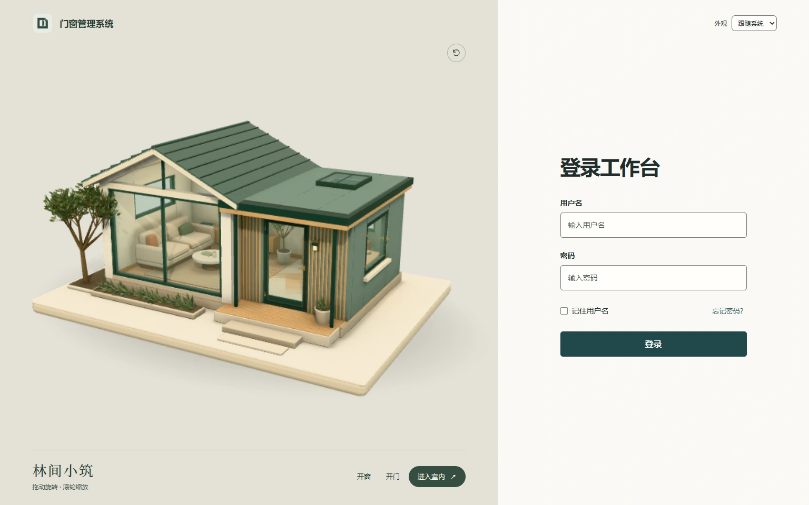
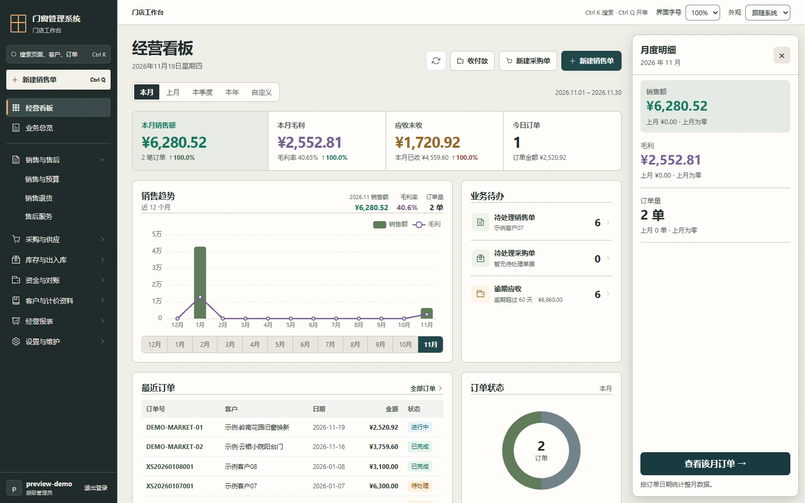
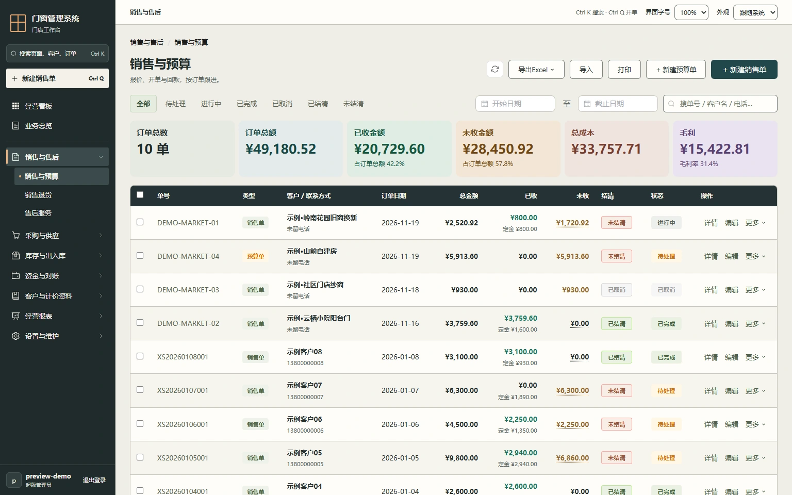
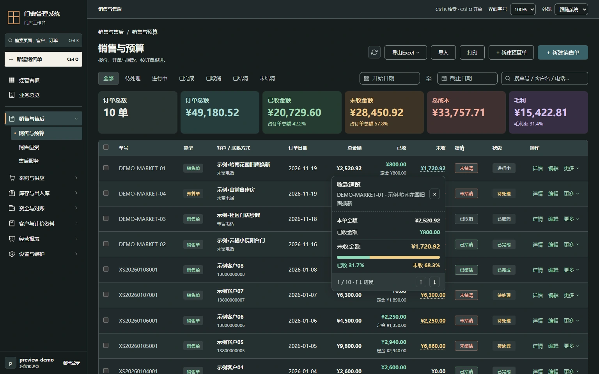
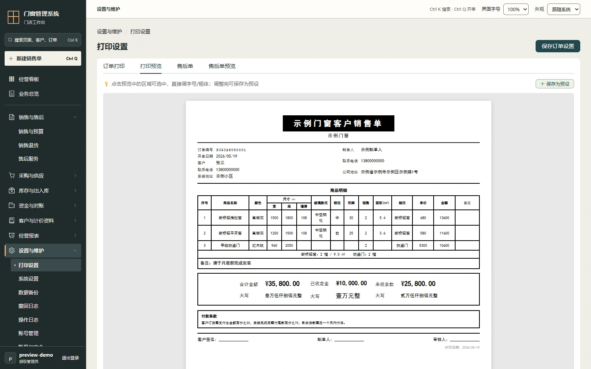

# 门窗管理系统

面向门窗定制门店的 Windows 桌面应用。用一套本地账套处理报价、销售、采购、库存、收付款和单据打印。

**[下载 v1.0.20 · Windows x64 MSI](https://github.com/YZzy2006/WindowSystemApp/releases/download/v1.0.20/WindowSystemApp-1.0.20-x64.msi)** · [版本说明与校验文件](https://github.com/YZzy2006/WindowSystemApp/releases/tag/v1.0.20)

## 安装与升级

1. 下载并运行 `WindowSystemApp-1.0.20-x64.msi`。安装包内置 Eclipse Temurin Java 17。电脑缺少 WebView2 时，安装程序可能需要联网获取运行时。
2. 新装首次启动时，选择空白正式账套或演示账套，再设置自己的管理员账号。初始化后可离线使用。
3. 从旧版升级时，先在「数据备份」页导出 ZIP，退出桌面程序及托盘进程，再运行新版安装包。启动后检查原有账套和打印设置。

## 核心功能

| 业务 | 功能 |
| --- | --- |
| 报价、销售与售后 | 预算单、销售单、收款、销售退货、售后处理，以及单据详情和批量操作 |
| 采购与库存 | 供应商、采购单、采购退货、入库、出库、商品及库存 |
| 财务与经营 | 资金流水、应收账龄、销售趋势、客户和商品排行 |
| 计价与打印 | 门窗计价公式、按单位计量、订单打印预览、纸张和样式预设、Excel 导出 |
| 系统维护 | 管理员与登录记录、操作日志、账套备份与恢复 |

## v1.0.20 界面

以下为 Windows 安装包中的实际页面，使用内置演示账套。

### 经营看板

点选销售趋势中的月份，可查看当月指标、上月对照，并进入该月的销售单列表。看板还显示客户与商品排行，以及分档的应收账龄。

### 销售与预算

销售单保留订单、结清和跟进状态及行内操作。收款用绿、未收用琥珀色、成本用陶红、毛利用紫色，方便在整张订单表里区分金额。

### 深色模式与收款速览

可选择浅色、深色或跟随系统，并在工作区调节字号。点击销售单的「未收」金额，可查看已收和未收金额及其占比。

### 打印预览

打印设置支持纸张、方向及样式预设。可在预览中检查订单信息、表体和金额汇总的格式，再打印实际单据。

## 源码与开发

本页的下载链接、功能说明和截图对应 **v1.0.20 桌面安装包**。仓库公开源码及 Release 中自动生成的源码归档对应当前提交，桌面安装包包含后续本地开发的功能。

- **桌面端**使用 Tauri 2 和 WebView2。安装包包含后端 JAR 和 Java 运行时。
- **前端**使用 Vue 3、Element Plus 和 ECharts。构建产物位于 `src/main/resources/static/`，由后端同源提供。
- **后端**使用 Java 17、Spring Boot 3 和 MyBatis-Plus。桌面版默认使用本地 H2 文件数据库。

### 从公开源码运行

Windows 开发环境使用 JDK 17、Maven、Node.js 和 npm。构建 MSI 还需要 Rust 和 Tauri 的 Windows 构建依赖。

在 PowerShell 中，复制本地配置模板，填好开发配置后启动后端。

~~~powershell
Copy-Item src/main/resources/application-local.example.yml src/main/resources/application-local.yml
mvn spring-boot:run
~~~

另开一个终端启动前端开发服务。Vite 将 API 请求转发到本机后端。

~~~powershell
npm --prefix frontend install
npm --prefix frontend run dev
~~~

从仓库根目录运行 `.\build-msi.bat` 可构建当前源码对应的 MSI，输出目录为 `src-tauri/target/release/bundle/msi/`。脚本会准备 Eclipse Temurin Java 17 运行时。

项目采用 [MIT 许可证](LICENSE)。安装包随附 Java 运行时许可证，对应的 [Temurin 17.0.21+9 源码](https://github.com/YZzy2006/WindowSystemApp/releases/download/v1.0.6/OpenJDK17U-jdk-sources_17.0.21_9.tar.gz) 可单独下载。
