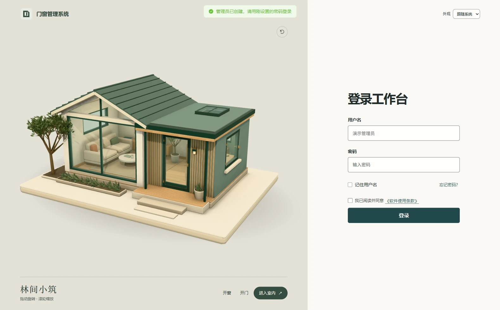
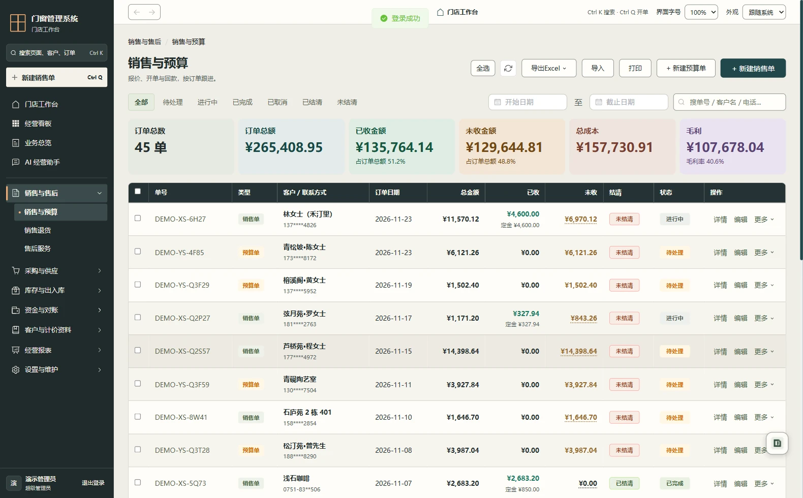
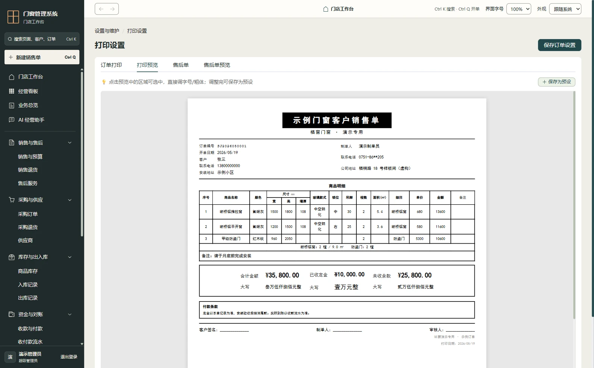
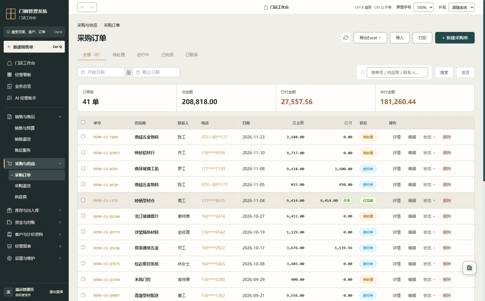
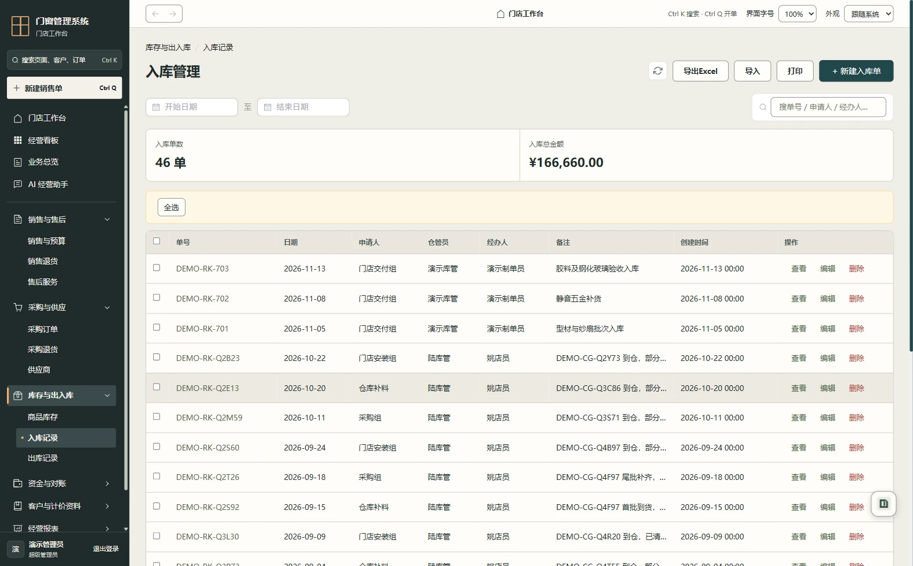
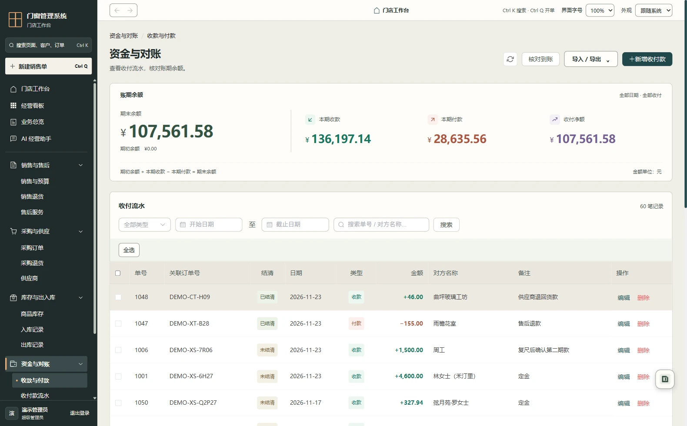
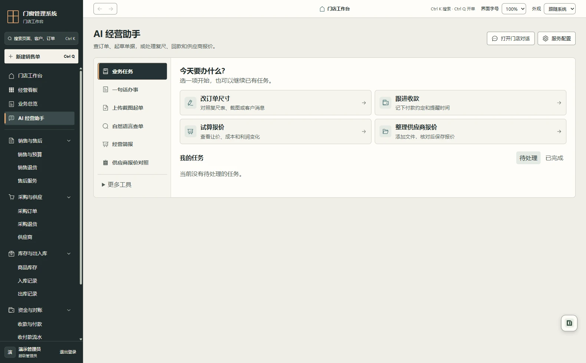
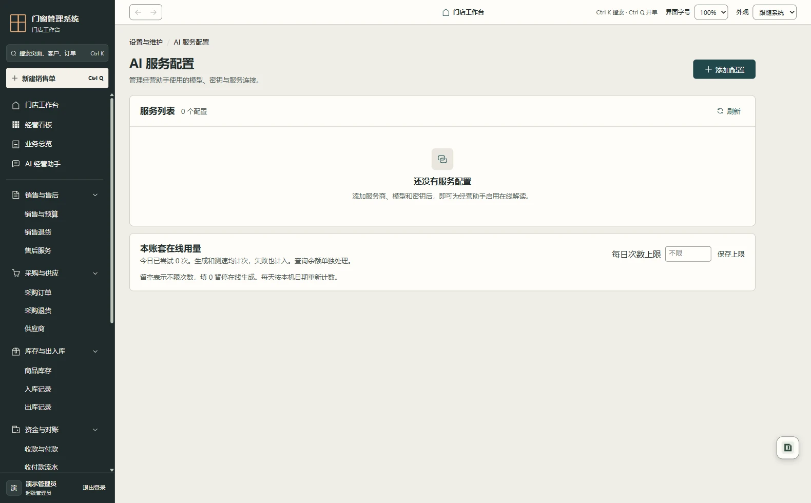

# 门窗管理系统

面向门窗定制门店的 Windows 桌面应用。用一套本地账套处理报价、开单、采购、库存、收付款和单据打印。常规业务与本地数据查询可离线运行，联网 AI 由超级管理员按需配置。

## 下载 Windows x64 v1.0.25

| 版本 | 适用场景 | 安装包 |
| --- | --- | --- |
| **纯净版** | 门店正式使用。新装首次创建管理员，打开空白业务账套。 | [下载纯净版 MSI](https://github.com/YZzy2006/WindowSystemApp/releases/download/v1.0.25/WindowSystemApp-1.0.25-x64-clean.msi) |
| **演示版** | 试用和现场讲解。新装自动准备独立演示账套，含虚构订单、客户、库存、应收和付款记录。 | [下载演示版 MSI](https://github.com/YZzy2006/WindowSystemApp/releases/download/v1.0.25/WindowSystemApp-1.0.25-x64-demo.msi) |

[发行说明与 SHA-256 校验](https://github.com/YZzy2006/WindowSystemApp/releases/tag/v1.0.25) · [历史发行](https://github.com/YZzy2006/WindowSystemApp/releases)

1. 下载对应的 MSI，运行安装程序。安装包随附 Eclipse Temurin Java 17。系统缺少 WebView2 时，安装程序可能需要联网补齐运行时。
2. 新装首次打开后设置管理员账号和密码。演示版的样例数据与正式账套分开，可从「设置与维护 → 系统设置」查看和切换账套。
3. 覆盖升级或切换版本前，从「数据备份」导出 ZIP，退出应用和托盘进程。安装后核对当前账套与打印设置。
4. 使用联网问答、识图等能力时，由超级管理员在「AI 服务配置」填写自己的服务商和密钥。两个公开安装包的 AI 服务商初始为空。

## 一张单怎样流转

| 环节 | 能处理什么 |
| --- | --- |
| 接单与报价 | 根据门窗宽、高、樘数和商品绑定的单位、公式计价。报价可转成正式销售单。 |
| 采购与库存 | 管理供应商报价，按采购原行和实际收货数量入库，跟踪分批到货、余量、退货及出库。 |
| 收款与经营 | 按单查看定金、已收和未收，在同一笔业务里追溯收款流水。看板可按月份钻取单据，并查看应收账龄。 |
| 打印与售后 | 核对模板、纸张及打印预览，记录售后与原订单关系。常用列表支持筛选、导出和批量操作。 |
| 维护 | 按账号授权，查操作日志，备份、恢复或切换本地账套。外观支持浅色、深色和跟随系统。 |

## 从操作入口到业务结果

### 门店工作台

鼠标移到展区即可打开同一业务下的常用操作。点击入口可直接跳转，顶部的前进、后退可返回最近浏览过的页面。

### 销售与预算、计价和打印

销售列表同时显示订单状态、已收和未收。录单按商品绑定的公式与单位计算，核对后可保存、查看收款构成或打开打印预览。

### 采购、供应商与库存

采购按原明细核对本次实收和待到数量。同一型号的不同规格分开入库。供应商报价支持表头映射、商品别名和导入前核对。

### 经营看板和对账

看板可按月查看销售、毛利和应收。收付款模块可核对原始流水，应收账龄可按开单天数追到原销售单。

### AI 经营助手

- **本地查单与核对**可用自然语言定位客户、商品和未收清的销售单，打开查询结果和原单。采购和客户往来摘要可直接从业务页面核对。
- **Agent 起单与交接**可核对订单信息、提取客户更正后的数量、保留来源并生成待确认的草稿。需要识图或在线生成时，选择支持对应能力的模型。
- **服务商由管理员管理**。支持新增、切换、测试连通、获取模型列表及查询服务商支持的余额。密钥在本机按账套保存，界面只显示掩码。

截图来自 v1.0.25 的测试账套，业务数据为虚构样例。[v1.0.20 界面记录](https://github.com/YZzy2006/WindowSystemApp/blob/bee6515d281326adf09e092ca307c8fe5d7a65ca/README.md)

## 源码与开发

本页的功能和截图对应 v1.0.25 Windows 安装包。仓库公开源码和 GitHub 自动生成的源码归档对应各自提交。

- 桌面端使用 Tauri 2 和 WebView2，安装包包含后端 JAR 和 Java 运行时。
- 前端使用 Vue 3、Element Plus 和 ECharts。生产构建输出至 `src/main/resources/static/`，由后端同源提供。
- 后端使用 Java 17、Spring Boot 和 MyBatis-Plus。桌面版使用独立的本地 H2 账套。

### 从公开源码运行

Windows 开发环境使用 JDK 17、Maven、Node.js 和 npm。构建 MSI 还需 Rust、MSVC 和 Tauri 的 Windows 构建依赖。按公开分支的锁文件选择相应 Node.js 版本。

~~~powershell
Copy-Item src/main/resources/application-local.example.yml src/main/resources/application-local.yml
mvn spring-boot:run
~~~

另开一个终端启动前端开发服务。Vite 会将 API 请求转发到本机后端。

~~~powershell
npm --prefix frontend install
npm --prefix frontend run dev
~~~

在公开源码对应的目录运行 `.\build-msi.bat` 可构建该提交的 MSI，输出位于 `src-tauri/target/release/bundle/msi/`。

项目采用 [MIT 许可证](LICENSE)。安装包随附 Java 运行时许可证，对应的 [Temurin 17.0.21+9 源码](https://github.com/YZzy2006/WindowSystemApp/releases/download/v1.0.6/OpenJDK17U-jdk-sources_17.0.21_9.tar.gz) 可单独下载。
